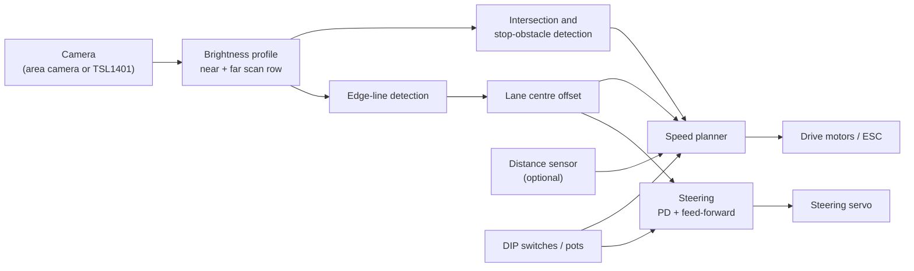

# Nordsee Nitro

Autonomous model car for the **NXP Cup EMEA 2026/2027**, built by team Nordsee Nitro from Bremerhaven.


## About

The NXP Cup is a student competition where teams build and program a small autonomous car. The car has to follow a track it has never seen, using a camera, as fast as it can, and then stop in front of an obstacle without touching it.

This repository holds everything for our car: the Gazebo simulation we develop the line follower in, and later the firmware, tuning tools and hardware notes. We are students at Hochschule Bremerhaven, right on the North Sea coast, which is where the name comes from.

## The challenge (2026/27 rules)

A short summary for the team. The [official rulebook](https://www.nxp.com/docs/en/supporting-information/NXP-CUP-RULEBOOK-2027.pdf) is always the reference.

| Topic | Rule |
|---|---|
| Track | 55 cm wide, matte white, 2 cm black line on each edge, crossings at 45° and 90° |
| Layout | Revealed shortly before the race, no practice on it |
| Sensing | A camera must be the primary navigation sensor, extra sensors are allowed |
| Autonomy | No wireless and no laptop during the race. In the 2 min prep we can only use on-board switches/knobs, adjust the camera angle, swap the battery and clean the wheels |
| Timed lap | 3 attempts at one lap, the **first** completed lap counts, 120 s limit |
| Intersections | The car must leave a crossing on the side opposite to where it entered |
| Stop | After the start/finish line, slow down and stop within 10 cm of a 20 × 20 × 20 cm white cube without touching it |
| Battery | NiCd, NiMH, Li-Ion or LiPo, max 6000 mAh, max 13 V |

**Scoring:** the fastest lap gets 650 points, then 550, 450, 400 and so on down to 100 for 10th place. A clean stop at the cube adds 150 points. Ties are broken by lap time.

## Design priorities

These follow directly from the scoring:

1. **Finish the first attempt.** Only the first completed lap counts, not the best one. A lap that always finishes beats a faster one that crashes half the time.
2. **Nail the stop.** The 150-point bonus is worth about two places on the leaderboard.
3. **Go straight through intersections.** Leaving a crossing on the wrong side voids the attempt.
4. **Tune without a laptop.** Every race-relevant parameter has to be selectable on the car itself.
5. **Then go fast.**

## System overview



- **Perception:** average a few image rows at a near and a far scan line into a brightness profile and find the inner edges of both black lines, searching only around last frame's positions. Pairs with the wrong spacing (start-line dashes, glare) are rejected. If one line leaves the image in a tight curve, the other one plus the known 55 cm track width gives the centre. At a crossing both lines vanish, so the car holds its last command for a short moment.
- **Steering:** PD on the near-row offset plus feed-forward from the far row.
- **Speed:** drops as the far row sees a curve coming, rises on straights.
- **Stop (not done yet):** the obstacle is a white cube on a white track, so the camera alone is unreliable for the last few centimetres. The plan is to detect it at range with the camera and use a distance sensor for the final approach.

The detection steps use integer maths per pixel, so the Python tracker in the simulation ports to C on the MCU almost line for line.

## Hardware

We are building the NXP 2025 3D-printed kit with the FRDM-MCXN947 board. The full parts list is on the [GitBook component list](https://nxp.gitbook.io/nxp-cup/2025-fall-2026-nxp-cup-mcxn947/assembly-and-hardware/component-list).

| Component | Choice |
|---|---|
| Chassis | NXP 2025 3D-printed kit |
| Main board | FRDM-MCXN947 |
| Camera | Kit camera, or a TSL1401 line-scan module (being evaluated, see below) |
| Steering, drive, ESC | As in the kit component list |
| Extra sensors | Distance sensor for the stop, _TBD_ |
| Battery | LiPo within the 6000 mAh / 13 V limit, plus a spare for swapping in the 2 min prep |

**TSL1401 option:** a single row of 128 greyscale pixels at up to 100 Hz with no processor on board, so it is allowed by the rules. Modules ship with a lens; the common 7.9 mm lens gives a 54° field of view, which means the sensor has to look about 50 cm ahead to see the whole track width. Both camera types are in the simulation (`camera:=linescan`), and the line-scan setup has done clean laps on the fast test bench at up to 2 m/s (not yet confirmed in Gazebo or on the real car).

The car dimensions in the simulation are placeholders close to the kit and get replaced with measured values once the car is built.

## Repository layout

```
ros/                         ROS 2 workspace packages (simulation)
  nxp_cup_description/       car model (xacro): Ackermann steering, camera, IMU
  nxp_cup_gazebo/            track generator, world, stop cube, bridge, sim.launch.py
  nxp_cup_control/           line follower: ROS-free core, ROS 2 node, lap monitor,
                             fast test bench (tools/fast_sim.py), unit tests
```

Still to come: `firmware/` for the MCXN947 code and `hardware/` for wiring, CAD and the BOM. If we modify a board or build our own, the rules require a technical report with a BOM, and that goes in `hardware/`.

## Getting started (simulation)

Tested on Ubuntu 26.04 with ROS 2 Lyrical and Gazebo Jetty. The repo is the `src` folder of a colcon workspace:

```bash
mkdir -p ~/nxp_ws/src && cd ~/nxp_ws/src
git clone -b ihtisham https://github.com/ihtishamarif/NXP_Cup_Nordsee_Nitro.git
cd ~/nxp_ws
rosdep install --from-paths src --ignore-src -y
colcon build --symlink-install
source install/setup.bash

ros2 launch nxp_cup_gazebo sim.launch.py follower:=true
```

Quick tuning without Gazebo (a lap takes a few seconds):

```bash
cd ~/nxp_ws/src/NXP_Cup_Nordsee_Nitro/ros/nxp_cup_control
python3 tools/fast_sim.py --laps 2
python3 tools/fast_sim.py --camera linescan
```

All launch options, the lap monitor's failure reports, other track layouts and how to match the model to the real car are in [`ros/README.md`](ros/README.md).

Build and flash instructions for the MCXN947 follow once the firmware exists.

## Race-day tuning

No laptop is allowed near the car during the race, so behaviour is set through on-board switches.

| DIP setting | Profile | When to use |
|---|---|---|
| `00` | Safe | The car has been unreliable on the test track |
| `01` | Medium | Default |
| `10` | Fast | Fast profile finished cleanly several times in practice |
| `11` | Test | Diagnostics, sensor check |

Since the first finished lap is the one that counts, pick the fastest profile that has finished **reliably** on the test track, not the fastest one that finished once.

## Roadmap

- [x] Gazebo simulation with a rulebook-accurate track and car model
- [x] Line follower closing laps in simulation (area camera and TSL1401)
- [x] Lap monitor that records why a run failed
- [ ] Register the team (closes January 2027)
- [ ] Order parts, assemble the car, drive servo and motors from the board
- [ ] Measure the real car and update the simulation model
- [ ] Port the tracker to C on the MCXN947
- [ ] Closed-loop line following on a real test track
- [ ] Intersections (45° and 90°) handled on the real car
- [ ] Stop within 10 cm of the obstacle
- [ ] Speed profiles selectable on the car
- [ ] Qualification event (spring 2027)
- [ ] EMEA Finals (May 2027)

## Team

| Name | GitHub | Focus |
|---|---|---|
| Ihtisham Arif | [@ihtishamarif](https://github.com/ihtishamarif) | Simulation, line follower |
| Ajim Tamboli | [@ajim141](https://github.com/ajim141) | _TBD_ |
| Niyaz Ahammad Shaik | [@Shaik-Niyaz-Ahammad](https://github.com/Shaik-Niyaz-Ahammad) | _TBD_ |

## Resources

- [NXP Cup rulebook 2026/27](https://www.nxp.com/docs/en/supporting-information/NXP-CUP-RULEBOOK-2027.pdf)
- [NXP Cup GitBook](https://nxp.gitbook.io/nxp-cup/) (kits, setup guides, example code)
- [NXP Cup EMEA](https://www.nxp.com/company/about-nxp/events/nxp-cup/nxp-cup-emea:NXP-CUP-EMEA)
- [NXP Cup Discord](https://discord.com/invite/3cdhBjpbAq)
- NXP application note AN4244 (line-scan camera with the TSL1401)

## License

_TBD_

---

Student team project. NXP and NXP Cup are trademarks of NXP B.V. This repository is not affiliated with or endorsed by NXP.
